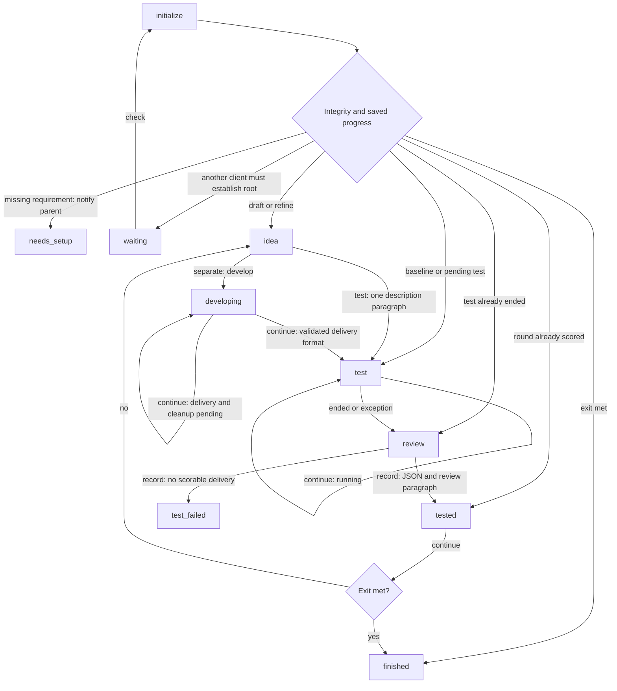
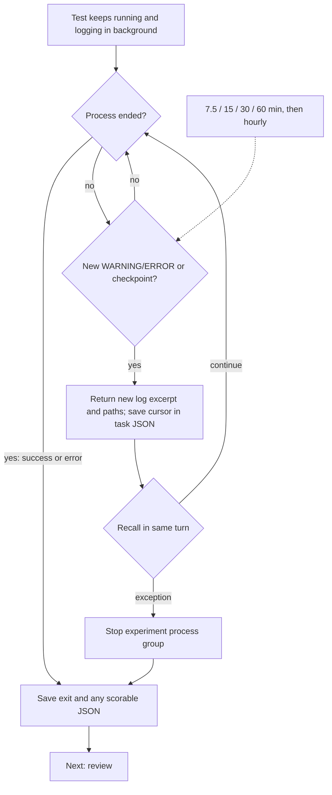
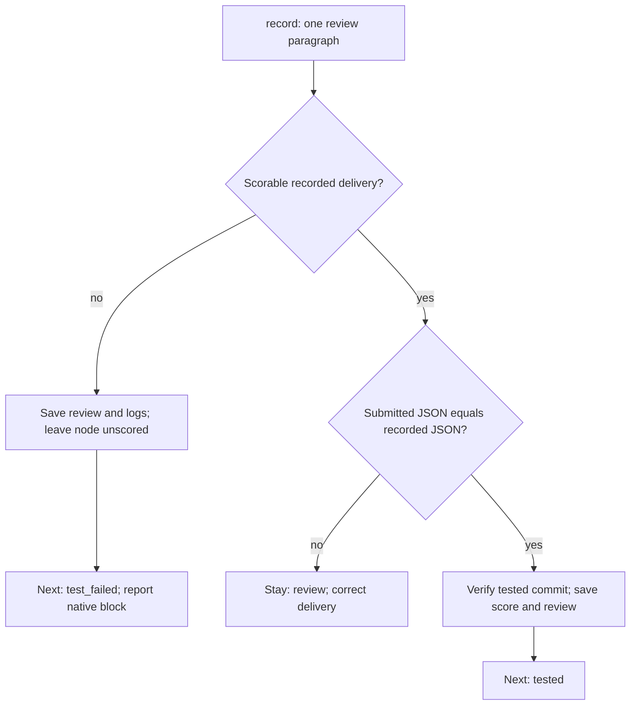

# Client protocol

The benchmark supplies `validate(solution)`, `score(delivery)` and
`is_complete(delivery)`. Nodes retain the full delivery, put-forward time and test
duration; the numeric score ranks parents. Each node retains one worktree and its
Git commit. Drafts branch from the prepared template, refinements from the selected
node's commit. Separate mode reuses the developer child created at installation.

State: `test`

State: `review`

