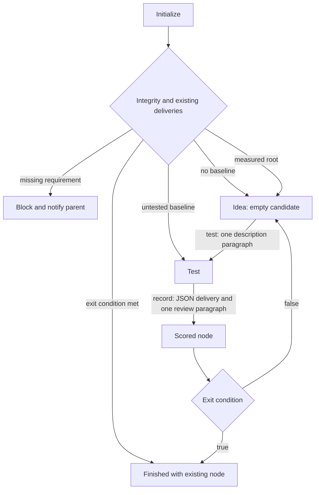
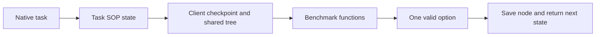

# Client protocol

The diamonds are scripted decisions. Each interaction state supplies one option.
The benchmark contract defines `validate(solution)`, `score(delivery)` and
`is_complete(delivery)`. The full JSON delivery is retained on the node; its numeric
projection selects future parents. Proposal and score registration record the
put-forward time and test duration. Initialization failure marks the client blocked
and sends the failed check to its parent.

