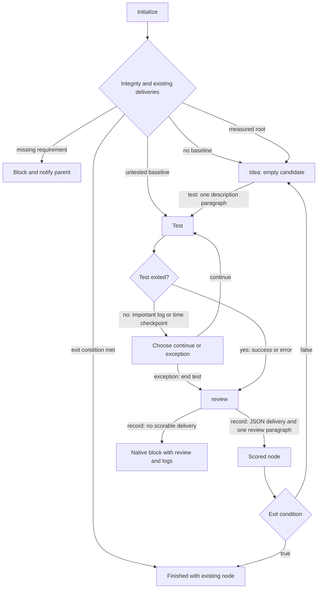
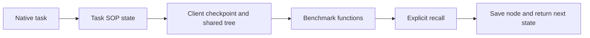

# Client protocol

The diamonds are scripted decisions. Test escalation supplies continue and exception.
Idea entry hands the candidate to the configured solver in a dev child, using the
workspace's existing native workdir helper. Native Multica owns its review and
acceptance.
The benchmark contract defines `validate(solution)`, `score(delivery)` and
`is_complete(delivery)`. The full JSON delivery is retained on the node; its numeric
projection selects future parents. Proposal and score registration record the
put-forward time and test duration. Initialization failure marks the client blocked
and sends the failed check to its parent. The official test runs in the background;
the monitor stays in the foreground and returns newly appended log excerpts.
The task's JSON record keeps its log offsets and 7.5/15/30/60-minute checkpoint
index; further checkpoints are hourly. Native child development follows its
ordinary delivery/block flow.

