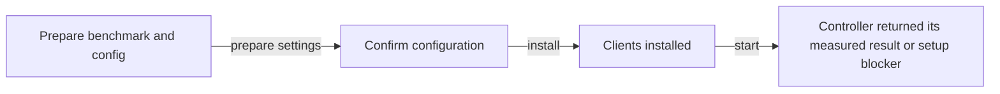
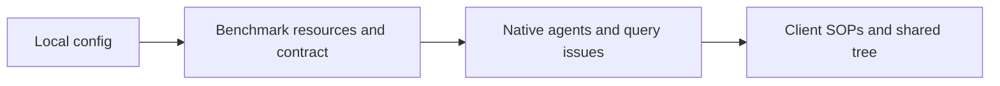

# Installation protocol

Preparation checks the official evaluator and benchmark contract. It uses the
existing native runtime. Installation creates only the feature's solver, client
issues and client SOP binding. The foreground controller starts the baseline client first;
all clients share the measured root and subsequent tree.

